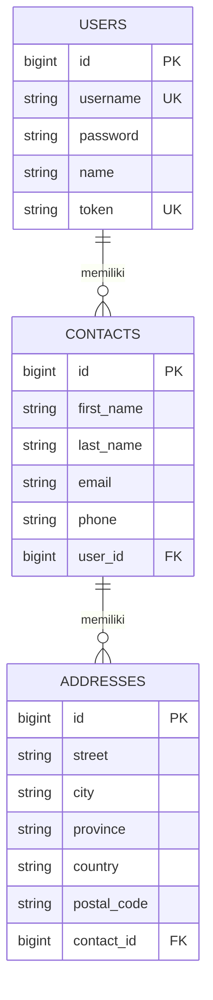

# Contact Management RESTful API

RESTful API untuk mengelola kontak dan alamat milik masing-masing pengguna, dibangun dengan **Laravel 11** dan **MySQL**. Proyek ini dibuat sebagai portfolio backend untuk menunjukkan penguasaan PHP framework, desain REST API, autentikasi berbasis token, validasi, relasi database, dan automated testing.

## Fitur

- **User** — registrasi, login (menghasilkan token), lihat/ubah profil, logout.
- **Contact** — CRUD kontak, dengan pencarian (nama, email, telepon) dan pagination.
- **Address** — CRUD alamat yang bersarang di bawah kontak (`/contacts/{id}/addresses`).
- **Isolasi data per user** — pengguna hanya bisa mengakses kontak dan alamat miliknya sendiri.
- **Validasi & error response konsisten** — semua error berformat JSON (`400`, `401`, `404`).
- **42 feature test** yang mencakup skenario sukses, gagal validasi, tidak terautentikasi, dan data tidak ditemukan.
- **Dokumentasi API** dalam format OpenAPI 3 (`docs/*.json`) dan contoh request siap pakai (`test.http`).

## Teknologi

| Bagian             | Teknologi                                         |
| ------------------ | ------------------------------------------------- |
| Bahasa / Framework | PHP 8.2+, Laravel 11                              |
| Database           | MySQL (Eloquent ORM, migration, seeder)           |
| Autentikasi        | Token kustom via middleware (`ApiAuthMiddleware`) |
| Validasi           | Form Request                                      |
| Output JSON        | API Resource & Resource Collection                |
| Testing            | PHPUnit (feature test)                            |
| Dokumentasi        | OpenAPI 3.0                                       |

## Struktur Database



## Daftar Endpoint

Base URL: `http://localhost:8000/api`

| Method | Endpoint                                      | Auth | Keterangan                                             |
| ------ | --------------------------------------------- | :--: | ------------------------------------------------------ |
| POST   | `/users`                                      |  –   | Registrasi user                                        |
| POST   | `/users/login`                                |  –   | Login, mengembalikan token                             |
| GET    | `/users/current`                              |  ✔   | Profil user yang sedang login                          |
| PATCH  | `/users/current`                              |  ✔   | Ubah nama / password                                   |
| DELETE | `/users/logout`                               |  ✔   | Logout (token dihapus)                                 |
| POST   | `/contacts`                                   |  ✔   | Buat kontak                                            |
| GET    | `/contacts`                                   |  ✔   | Cari kontak (`name`, `email`, `phone`, `page`, `size`) |
| GET    | `/contacts/{id}`                              |  ✔   | Detail kontak                                          |
| PUT    | `/contacts/{id}`                              |  ✔   | Ubah kontak                                            |
| DELETE | `/contacts/{id}`                              |  ✔   | Hapus kontak                                           |
| POST   | `/contacts/{idContact}/addresses`             |  ✔   | Tambah alamat                                          |
| GET    | `/contacts/{idContact}/addresses`             |  ✔   | Daftar alamat milik kontak                             |
| GET    | `/contacts/{idContact}/addresses/{idAddress}` |  ✔   | Detail alamat                                          |
| PUT    | `/contacts/{idContact}/addresses/{idAddress}` |  ✔   | Ubah alamat                                            |
| DELETE | `/contacts/{idContact}/addresses/{idAddress}` |  ✔   | Hapus alamat                                           |

Endpoint bertanda ✔ membutuhkan header `Authorization: <token>` (token dari response login, tanpa prefix `Bearer`).

## Contoh Penggunaan

**Login**

```http
POST /api/users/login
Content-Type: application/json

{ "username": "ervan", "password": "rahasia" }
```

```json
{
    "data": {
        "id": 1,
        "username": "ervan",
        "name": "Fernanda Ervan Rustyawan",
        "token": "f2234539-d8e3-4939-9c46-2c45721b5160"
    }
}
```

**Membuat kontak**

```http
POST /api/contacts
Authorization: f2234539-d8e3-4939-9c46-2c45721b5160
Content-Type: application/json

{ "first_name": "Budi", "last_name": "Santoso", "email": "budi@example.com", "phone": "081234567890" }
```

```json
{
    "data": {
        "id": 1,
        "first_name": "Budi",
        "last_name": "Santoso",
        "email": "budi@example.com",
        "phone": "081234567890"
    }
}
```

**Mencari kontak** — `GET /api/contacts?name=budi&size=5&page=1` mengembalikan `data` beserta `links` dan `meta` pagination bawaan Laravel.

**Format error**

| Status                     | Contoh                                                                  |
| -------------------------- | ----------------------------------------------------------------------- |
| `400` validasi gagal       | `{ "errors": { "first_name": ["The first name field is required."] } }` |
| `401` tidak terautentikasi | `{ "errors": { "message": ["unauthorized"] } }`                         |
| `404` data tidak ditemukan | `{ "errors": { "message": ["not found"] } }`                            |

## Instalasi

Prasyarat: PHP 8.2+, Composer, MySQL.

```bash
git clone https://github.com/fernandaervan28/contact-management-restful-api.git
cd contact-management-restful-api

composer install
cp .env.example .env
php artisan key:generate
```

Buat database `contact_management` di MySQL, sesuaikan `DB_USERNAME` / `DB_PASSWORD` di `.env`, lalu:

```bash
php artisan migrate
php artisan db:seed      # opsional: data demo
php artisan serve        # http://localhost:8000
```

Akun demo hasil seeder: username `test`, password `test`, token `test`.
Contoh request lengkap tersedia di `test.http` (ekstensi _REST Client_ VS Code) dan spesifikasi OpenAPI di folder `docs/`.

## Menjalankan Test

> **Perhatian:** test menghapus seluruh isi tabel `users`, `contacts`, dan `addresses` pada setiap test (lihat `tests/TestCase.php`). Karena itu `phpunit.xml` diarahkan ke database terpisah, `contact_management_test`.

```bash
# buat database kosong bernama contact_management_test, lalu:
DB_DATABASE=contact_management_test php artisan migrate
php artisan test
```

## Struktur Proyek

```
app/
├── Http/
│   ├── Controllers/      # UserController, ContactController, AddressController
│   ├── Middleware/       # ApiAuthMiddleware (autentikasi token)
│   ├── Requests/         # Form Request: validasi input
│   └── Resources/        # Transformasi output JSON
└── Models/               # User, Contact, Address (+ relasi Eloquent)
database/
├── migrations/           # users, contacts, addresses
└── seeders/              # data demo & data uji
docs/                     # spesifikasi OpenAPI (user, contact, address)
routes/api.php            # definisi seluruh endpoint
tests/Feature/            # UserTest, ContactTest, AddressTest
```

## Keputusan Desain

- **Form Request + API Resource** memisahkan validasi dan bentuk output dari controller, sehingga controller tetap ringkas.
- **Kepemilikan data diperiksa di setiap query** (`where user_id = ...`). Mengakses kontak milik user lain menghasilkan `404`, bukan `403`, supaya keberadaan data tidak bocor.
- **Alamat divalidasi berjenjang**: kontak harus milik user, lalu alamat harus milik kontak tersebut.
- **Route parameter dibatasi regex** (`[0-9]+`) agar request dengan ID tidak valid ditolak di level routing.
- **Password di-hash** dengan `Hash::make` (bcrypt); token dibuat sebagai UUID saat login dan dihapus saat logout.

## Rencana Pengembangan

- Memindahkan autentikasi ke Laravel Sanctum (sudah terpasang di `composer.json`) dengan token yang di-hash dan masa berlaku.
- Menambahkan rate limiting pada endpoint login.
- Memindahkan pengecekan username unik ke Form Request (`unique` rule) agar validasi terpusat.
- Menambahkan CI (GitHub Actions) untuk menjalankan test otomatis dan Docker untuk setup yang seragam.

## Penulis

**Fernanda Ervan Rustyawan** — [fernandaervan@gmail.com](mailto:fernandaervan@gmail.com) · [LinkedIn](https://www.linkedin.com/in/fernanda-ervan-rustyawan-6275b01a3/) · [GitHub](https://github.com/fernandaervan28)
